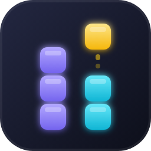

<p align="center">
  
</p>

<h1 align="center">Tetrix — Break Timer</h1>

<p align="center">
  Staring at code for hours in a row kills your focus. Tetrix is a mini Tetris game built right into VS Code that steps in between two intense coding sessions, giving your brain a real, deliberate pause instead of another five minutes doomscrolling. Once the break starts, a cooldown locks the game back up — so it stays a reset, not a distraction.
</p>

## Screenshots

<table>
  <tr>
    <td align="center">
      <br/>
      <sub>In game</sub>
    </td>
    <td align="center">
      <br/>
      <sub>Locked (break cooldown)</sub>
    </td>
  </tr>
</table>

## How it works

- Open the game from the **Tetrix** icon in the Activity Bar (left sidebar) — it plays right there, no new editor tab.
- You can play a limited number of games per break (`tetrix.maxGamesPerBreak`).
- Once that quota is reached, the game **locks for `tetrix.cooldownMinutes` minutes** (30 min by default): no new game can start until the countdown — shown live in the sidebar and in the status bar — reaches zero.
- Optionally, cap the number of breaks per day and/or the maximum duration of a single break.

## Commands

| Command | Description |
|---|---|
| `Tetrix: Take a Break` | Opens the Tetrix view in the sidebar |
| `Tetrix: Show Break Status` | Shows the current state (available / locked / limit reached) |
| `Tetrix: Reset State (debug)` | Resets the cooldown and counters |

## Controls

- `←` `→`: move
- `↑`: rotate
- `↓`: soft drop
- `Space`: hard drop
- `P`: pause
- `Enter`: play again (when a game is still available in the current break)

## Settings (`settings.json`)

| Key | Default | Description |
|---|---|---|
| `tetrix.cooldownMinutes` | `30` | Lock duration after a break |
| `tetrix.maxGamesPerBreak` | `1` | Number of games allowed per break |
| `tetrix.maxBreaksPerDay` | `0` (unlimited) | Maximum number of breaks per day |
| `tetrix.breakDurationMinutes` | `0` (disabled) | Auto-closes the game after X minutes, regardless of games left |
| `tetrix.showStatusBarItem` | `true` | Shows the Tetrix status in the status bar |

Example for a looser configuration (3 games, 15 min lock, 5 breaks/day max):

```json
{
  "tetrix.maxGamesPerBreak": 3,
  "tetrix.cooldownMinutes": 15,
  "tetrix.maxBreaksPerDay": 5
}
```

## Development

```bash
npm install
npm run compile
```

Then press `F5` in VS Code to launch a development window with the extension loaded.

## Bugs & Suggestions

Tetrix is open source. Found a bug, have an idea for a new setting, or just want to suggest an improvement? Head over to the GitHub repository and open an issue — contributions and pull requests are welcome too!

[github.com/r-seize/Tetrix](https://github.com/r-seize/Tetrix)

## Links

- Repository: [github.com/r-seize/Tetrix](https://github.com/r-seize/Tetrix)
